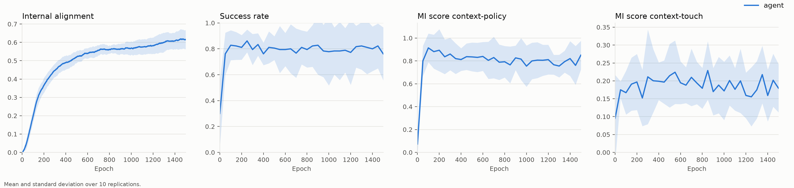
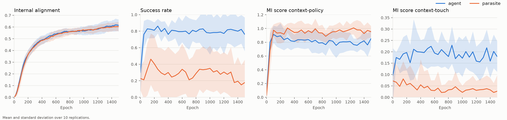
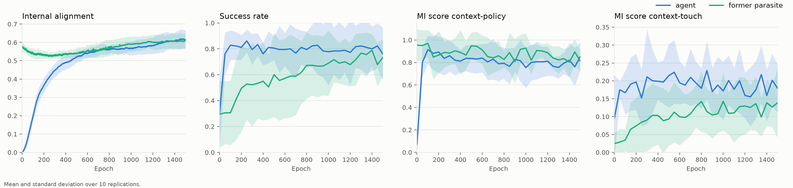
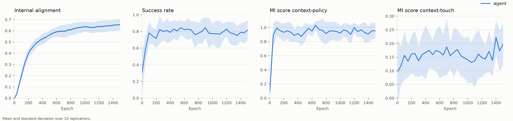
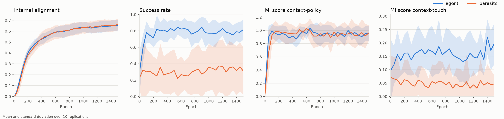
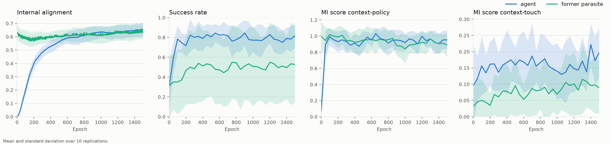
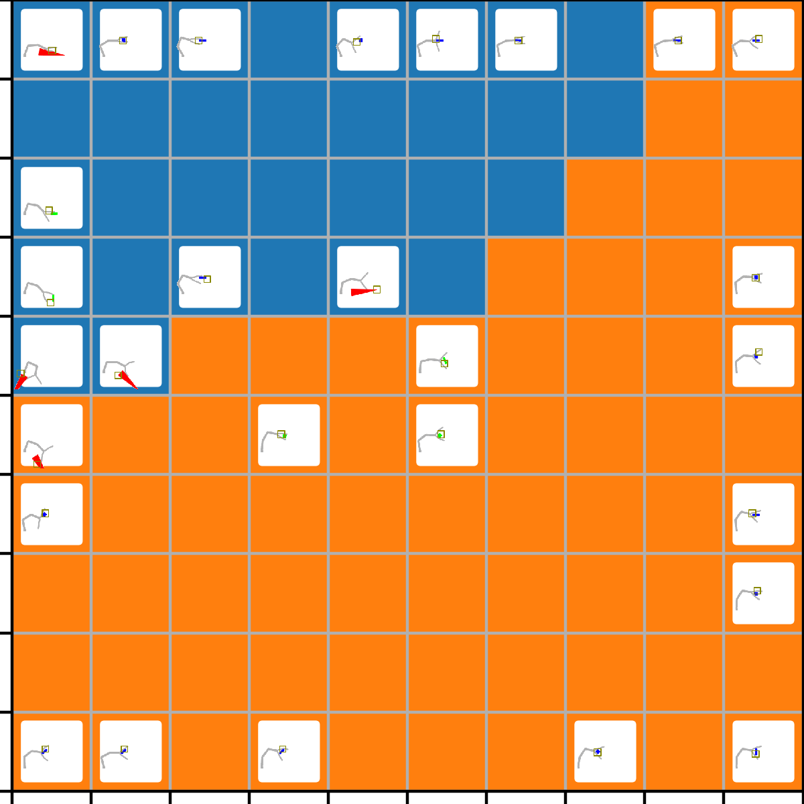

# Actuator and policy-map learning: modifications, experiments and findings

Period: 2026-10-17 to 2026-10-19. Branch `all_maps_anchored` (on top of `speed_cheap_wins` at `7d29807`). Draft reference: `knowledgebase/goal-formation.pdf`, formalisation `knowledgebase/topological_alignment_formalization.html`.

## 1. Summary

1. The original grip actuator is effectively open loop. Its output is driven by eye position only (touch and posture contribute nothing), 99.9% of nonzero outputs are clipped, and a policy is in practice one fixed 5-dimensional action. Episode success (0.81) is reached with touch, posture and eye removed, and policies shuffled, randomised or replaced by a constant mean policy still reach 0.64 to 0.77. Goal-specific precision is at chance in every condition tested.
2. Policy learning is dominated by noise. Executed policies are the prototype plus noise whose standard deviation stays near 11 (the policy parameters have standard deviation 1.1, and an amplitude factor of 8 scales both), so the nearest policy prototype of an executed policy is the node it came from only 4 to 20% of the time. At most about one success per goal node per epoch is available to learn from.
3. Replacing the Adam step of the policy map by an averaged update (EMA, eq. 9 of the formalisation) with an anchored winner raises alignment, touch frequency and the correct-winner rate at unchanged success. Over 500 epochs and 6 seeds: alignment 0.493 against 0.456, touch frequency 0.163 against 0.135, executed-policy winner equal to the goal node 77% against 63%.
4. Block-normalised actuator encodings (RBF or winner-take-all per input block, tanh output, touch gain 3) put all inputs into the output but, on their own, do not beat the original actuator at 150 epochs. Output saturation does not limit success (success depends on the sign pattern of the five outputs, not on their magnitude). A whitened-subspace policy parametrisation did not help.
5. A full Figs 5-7 sweep (10 seeds, 1500 epochs) with the improved configuration reproduces the draft's qualitative claims: the parasite aligns its maps as well as the active agent (0.59 against 0.59) but does not gain control (success 0.26 against 0.79), and the former parasite does not learn faster than the agent (its mean success reaches 0.6 at epoch 500, the agent's at epoch 50).
6. Applying the anchored winner rule to all maps (visual, touch, proprioception, as already done for the policy map) raises final alignment by about 8% (0.640 against 0.592) and context-policy information by 0.15, leaves final success equal, and lowers context-touch information by 0.02 to 0.03. It also makes 4 of 10 former parasites fail to recover (success 0.04 to 0.16, against 0.55 to 0.87 for every former parasite in the previous sweep).
7. The four stuck former parasites are consistent with the draft's account that alignment learned in a yoked condition is not grounded in action: their effect maps are rewritten by more than their own norm, but their policy map stays frozen (1% change at epoch 51) because high imported competence switches off exploration while their loaded policies hardly touch the object.

## 2. Context and question

The draft's Result 3 says that pretraining as a parasite does not speed learning. In earlier reruns of Figs 5 to 7 the former parasite relearned quickly, and the working explanation was that the active agent's policies are coarse and independent of map topology. This report records the investigation of the actuator and of the policy-map learning rule that followed, the measurements that tested that explanation, and the sweeps that rebuild Figs 5 to 7 with the changes. The original-actuator figures were not rebuilt (see section 9).

Terminology. "Alignment" is `grid_comp_mean`, the mean over the 100 goal nodes of the tanh-scaled predicted competence; it is the quantity the draft calls internal alignment. "Active agent" is the agent of a `--parasite` run, identical to a plain run. "Former parasite" is a plain run started from the parasite's weights at its epoch-1000 checkpoint (1001 epochs of pretraining, because checkpoints are every 50 epochs).

## 3. Modifications to the actuator

Files: `src/Actuator.py`, `src/GripAgent.py`, `src/SMAgent.py`, `src/params.py`, `src/GripMapping.py`, `src/grip_map_v2.py`, `src/grip_basis.py`. All new parameters default to the previous behaviour, which was checked by reproducing the previous runs' weights (maximum difference 1e-8, float rounding).

| parameter | values (default first) | effect |
|---|---|---|
| `grip_map_name` | `data/StoredGripActuatorMap` | input map: 47 inputs (40 touch, 5 posture, 2 eye) to 75 hidden units (3 blocks of 25) |
| `grip_input_norm` | `none`, `block_rms` | per-input standardisation from stored statistics (`grip_norm_name`) |
| `grip_encoding` | `linear`, `wta_block`, `rbf_block` | linear map; nearest prototype of each block with a Gaussian bump over the 5x5 block grid; normalised radial activation of each block |
| `grip_out_fn` | `clip`, `tanh` | output nonlinearity |
| `grip_touch_gain` | 1.0 | multiplier of the touch block |
| `grip_basis_name`, `grip_policy_dim` | none | whitened PCA basis of the hidden activity; the policy has `r x 5` weights instead of `75 x 5` |

Input maps. `src/grip_map_v2.py` collects babbling data in the agent's own action space (actuator outputs in [-1, 1]^5 mapped as in `SMAgent.step`) and trains the three block maps after resampling touch frames so that the four sensor groups carry equal mass; per-block normalisation statistics and encoding gains are stored with the map. `v3` is the balanced map used by the improved configuration, `v3s` adds synthetic touch patches, `oldnorm` normalises the original data. `src/data/StoredGripActuatorMap_v3.npy` and `StoredGripActuatorNorm_v3.npz` are committed; the other maps are in the archive (section 10). `src/grip_basis.py` builds the subspace basis (27 of 75 components for 99% of the hidden second moment).

Improved actuator ("D_tanh_tg3"): v3 map, `block_rms`, `rbf_block`, `tanh`, touch gain 3.

## 4. Modifications to the learning rule

Files: `src/stm.py`, `src/SMController.py`, `src/params.py`.

| parameter | values (default first) | effect |
|---|---|---|
| `policy_winner` | `argmin`, `anchored`, `forced` | which node wins the competition for the executed policy in the policy map |
| `policy_update` | `adam`, `ema` | optimiser step or averaged update for the policy map |
| `policy_ema_eta` | 0.05 | rate of the averaged update |
| `map_winner` | `argmin`, `anchored` | the anchored rule for the visual, touch and proprioception maps (policy map unaffected) |

Winner rules. `argmin` is the previous behaviour (nearest prototype of the noisy executed policy). `forced` makes the goal node the winner. `anchored` takes the nearest prototype under a penalty for distance from the goal: the winner is `argmin_k ||x - w_k||^2 / (A_k / max A)`, where `A` is the goal representation (a Gaussian of width `representation_sigma` = 2 around the goal node). With strong noise the data term carries no information and `anchored` equals `forced`; with weak noise it equals `argmin`. At the noise used in the first experiments the anchored and forced runs gave identical weights.

Correction to the formalisation. Taken literally, eq. 5 (the exact E-step) minimises a sum in which the anchor appears as a multiplier `exp(-d^2 / 2 sigma_t^2)`. That sum is smallest when the neighbourhood and the anchor barely overlap, so the winner moves away from the anchor (a test gave a median distance of 10.1 grid units from the goal against 5.1 for plain `argmin`). The penalty form above is the intended behaviour. The same statement of the limit "winner close to the anchor" in the text is inverted as written.

Averaged update. `policy_update = ema` implements the online rule of eq. 9, `w_j += eta phi_ij (d - w_j)`, in a bounded batch form: with `phi` the neighbourhood around the winner times the anchor weight, `S_j = sum_i phi_ij`, the weights move by `eta S_j / (1 + S_j)` toward the `phi`-weighted mean of the executed policies at node j. The Adam step it replaces rescales every gradient to a step of about the learning rate, so it cancels the local learning-rate modulation: the mean absolute weight change was 0.100 for modulation scales 0.1, 1 and 10 (this is the check of `reports/05` item 2, now confirmed; a loaded optimiser state was not available, so it was tested with a fresh optimiser).

Anchored winner on all maps. For the touch and proprioception maps the anchor rows are `goals[match_ind]`; for the visual map they are the goal at the moment each condition window was selected (`goals_cond`). The M-step of the sensory maps is unchanged (Adam).

Policy noise and scale (parameters unchanged, relevant for the findings). Executed policy = prototype + noise with standard deviation `0.01 + 20 x local incompetence`; the result is multiplied by `policy_params_amplitude` = 8 before it reaches the actuator.

## 5. Tooling

| script | purpose |
|---|---|
| `launch_run.py`, `launch_experiment.py` | single runs and parasite/former pairs (earlier commits) |
| `launch_conditions.py`, `launch_sweep.py` | named conditions (lists of `KEY=VALUE` options) times seeds, job pool |
| `launch_fig567.py` | full Figs 5-7 sweep: parasite runs, former runs started from the epoch-1000 parasite weights as soon as that checkpoint exists, `--stages parasite,former`, a janitor that deletes intermediate `data.npy`, a progress file and the final figures |
| `plot_actuator_pilots.py` | learning curves and tables of condition sets |
| `diagnose_input_layer.py`, `saturation_touch.py`, `policy_controls.py`, `policy_topology.py`, `policy_subspace.py` | input-layer, saturation, control, topography and null-space diagnostics |
| `best_goal_trajectories.py`, `policy_demos.py`, `green_demos.py` | find segments in which touch and proprioception converge on the goal, rank seeds, render demo animations |
| `fig4_seed.py` | Figure 4 (goal-posture grid) for the active agent of one seed |
| `plot_postures.py` (changed) | sketch window fitted to the arm over all frames; poses fade by age so the current pose and gripper stay opaque; legend above the small grid; larger crop of the environment render; thumbnails scaled to the whole scene |
| `SMGraphs.py` (changed) | `plt.get_cmap("tab20").resampled(10)` (the old `plt.cm.get_cmap` is gone in Matplotlib 3.9) |

Runs are tracked in a local database (`localwandb`); `localwandb_server.py` serves it with a figures page.

## 6. Experiments on the actuator (3 seeds, 150 epochs, means over epochs 100 to 150)

| condition | success | alignment | touch freq | MI context-touch |
|---|---|---|---|---|
| baseline (original actuator, default parameters) | 0.809 | 0.156 | 0.067 | 0.169 |
| old map, normalised, linear | 0.626 | 0.074 | 0.033 | 0.062 |
| v3, linear | 0.448 | 0.117 | 0.033 | 0.070 |
| v3s, linear | 0.466 | 0.120 | 0.029 | 0.059 |
| v3, WTA | 0.701 | 0.146 | 0.051 | 0.115 |
| v3, RBF | 0.732 | 0.170 | 0.044 | 0.113 |
| RBF, tanh | 0.713 | 0.143 | 0.056 | 0.124 |
| RBF, touch gain 3 | 0.732 | 0.180 | 0.065 | 0.162 |
| RBF, tanh, touch gain 3 (D_tanh_tg3) | 0.775 | 0.182 | 0.073 | 0.231 |

(The baseline here is a fresh default-actuator run, not the earlier `parasite_NNN` runs, which were lost.) Encoding matters more than the map; block encodings recover most of the gap to the baseline, none exceeds it in success.

## 7. Diagnostics

Saturation and touch use (`saturation_touch.py`). Rescaling the policy weights at evaluation by 1, 0.3, ..., 0.01 reduces the clipped fraction from 0.99 to 0.27 for the RBF actuator while success stays at 0.74 to 0.81, and the baseline keeps 0.83 even at scale 0.0001. Success therefore depends on the sign pattern, not the magnitude. Removing touch changes success by at most about 0.05 at every scale, although touch flips the sign of 7 to 24% of the outputs on contact frames in the new conditions (0.1% in the baseline). Success is reachable open loop, so touch ablation cannot detect closed-loop use. For the baseline, touch contributes exactly zero to the output and the policy is a single fixed action.

Policy content (`policy_controls.py`, epoch 149). Intact, shuffled, random-with-same-statistics and constant-mean policies: baseline 0.81, 0.77, 0.74, 0.64; D_tanh_tg3 0.79, 0.78, 0.84, 0.65. Mean distance between the goal node and the touch representation is about 5 in every condition (chance 5.2).

Null space (`policy_subspace.py`). Relative to the hidden-activity subspace of the data, 77 to 99% of the policy weight energy lies outside it in every condition. The baseline's hidden activity has a participation ratio of 1.06; the RBF and WTA conditions need 6 to 17 components for 95% of the variance. For the linear conditions the share outside the span of the input map is 0.57 (the random value). Weights are as smooth on the grid as the sensory maps (neighbour ratio 0.25, rho 0.9 against 0.26 to 0.37), and equally smooth inside and outside the data subspace; action space is rougher (ratio 0.41 to 0.44).

Why the policy map learns slowly. At the prototype scale reached by training the nearest prototype of a noisy executed policy is its source node 63%, 19% and 7% of the time at noise 2, 5 and 11 (4 to 20% at noise 5 to 20; logged executed-policy winner equal to the goal 14 to 21%). Successes are rare: 51% of (epoch, goal node) cells have exactly one event, with about 7 goal nodes receiving events per epoch.

## 8. Experiments on the learning rule

Short probes (3 seeds, 150 epochs, epochs 100 to 150, control = D_tanh_tg3). "Winner = goal" is the share of steps in which the executed policy's nearest prototype is the goal node.

| condition | success | alignment | touch freq | MI ctx-touch | winner = goal |
|---|---|---|---|---|---|
| control (Adam, argmin, noise 20, amplitude 8) | 0.775 | 0.186 | 0.074 | 0.231 | 21% |
| forced winner, Adam | 0.796 | 0.189 | 0.058 | 0.189 | 18% |
| EMA, argmin | 0.725 | 0.214 | 0.108 | 0.184 | 32% |
| EMA, forced = anchored | 0.775 | 0.250 | 0.111 | 0.173 | 43% |
| subspace policy only | 0.735 | 0.161 | 0.049 | 0.122 | 9% |
| subspace, amplitude 1, noise 0.3 | 0.429 | 0.132 | 0.056 | 0.074 | 51% |
| subspace, amplitude 1, noise 0.3, EMA anchored | 0.164 | 0.079 | 0.017 | 0.012 | n/a |
| EMA anchored, amplitude 1, noise 0.3 | 0.577 | 0.250 | 0.101 | 0.113 | 67% |
| EMA anchored, amplitude 2, noise 0.15 | 0.642 | 0.187 | 0.069 | 0.108 | 85% |
| EMA anchored, amplitude 4, noise 0.075 (S4) | 0.636 | 0.266 | 0.091 | 0.124 | 90% |
| EMA anchored, amplitude 8, noise 0.0375 | 0.448 | 0.180 | 0.076 | 0.093 | 99% |
| S4 with `policy_ema_eta` 0.2 | 0.719 | 0.300 | 0.137 | 0.155 | 52% |

Findings. Forcing the winner without the averaged update does nothing, because Adam rescales every step. The averaged update is the main ingredient and the forced or anchored winner adds credit assignment. Lowering the amplitude and the noise makes credit assignment accurate but the actions weak (raw output 0.2 to 1.7 against 130 to 190), and success follows vigour of movement, not learning quality (a constant policy reaches 0.64). The whitened subspace did not help in any combination. A larger averaging rate recovers map topography and gives the best 150-epoch alignment (3 seeds only).

Long run (6 seeds, 500 epochs): control against EMA anchored (U1) against S4.

| epochs 400-500 | control | U1 | S4 |
|---|---|---|---|
| success | 0.775 +- 0.15 | 0.826 +- 0.07 | 0.637 +- 0.13 |
| alignment | 0.456 +- 0.03 | 0.493 +- 0.04 | 0.473 +- 0.03 |
| touch frequency | 0.135 | 0.163 | 0.128 |
| MI context-touch | 0.177 | 0.181 | 0.130 |
| winner = goal | 63% | 77% | 74% |

U1 is the only variant that improves on the control in every window and was chosen for the sweeps below. Policy content still barely matters at epoch 499 (success gap intact minus shuffled and random: +0.02 control, +0.04 U1, -0.07 S4).

## 9. Full Figs 5-7 sweeps (10 seeds, 1500 epochs, former parasites from the epoch-1000 parasite weights)

Two configurations, both with the D_tanh_tg3 actuator and the U1 policy rule (EMA, anchored winner). "Improved" has `map_winner = argmin`; "all-maps" has `map_winner = anchored`. The original actuator with the default rule was not rebuilt: its first full sweep was stopped (12 minutes in) when the configuration was changed, and the earlier `parasite_NNN` runs had been lost.

Improved configuration (`experiments/fig567_improved`), mean +- sd over seeds, epochs 1000 to 1500:

| | alignment | success | MI context-policy | MI context-touch |
|---|---|---|---|---|
| active agent | 0.592 +- 0.044 | 0.794 +- 0.182 | 0.793 | 0.181 |
| parasite | 0.589 +- 0.032 | 0.259 +- 0.234 | 0.969 | 0.031 |
| former parasite | 0.601 +- 0.037 | 0.719 +- 0.120 | 0.859 | 0.126 |

The former parasite starts with high alignment (0.556 over epochs 0 to 100) and context-policy information (0.95), but its success starts at 0.30 and its mean reaches 0.6 only at epoch 500 (the agent at epoch 50).

All-maps anchored (`fig567_all_maps_anchored`), difference against the improved sweep (all 10 seeds, paired by seed):

| epochs | alignment (agent) | success (agent) | MI ctx-policy (agent) | MI ctx-touch (agent) |
|---|---|---|---|---|
| 0-100 | 0.084 against 0.082 | 0.447 against 0.531 | 0.484 against 0.437 | 0.107 against 0.135 |
| 100-400 | 0.419 against 0.393 | 0.780 against 0.825 | 0.942 against 0.868 | 0.152 against 0.186 |
| 400-1000 | 0.595 against 0.545 | 0.808 against 0.798 | 0.948 against 0.815 | 0.166 against 0.199 |
| 1000-1500 | 0.640 against 0.592 | 0.784 against 0.794 | 0.944 against 0.793 | 0.160 against 0.181 |

The advantage in alignment (+0.03 to +0.05) is about one between-seed standard deviation and holds in 7 of 10 seeds up to epoch 1000, 5 of 10 afterwards. Parasite alignment matches the agent's in both sweeps, and the parasite's success stays low (0.34 +- 0.28 against 0.26 +- 0.23).

Former parasite, all-maps against improved: alignment 0.613 against 0.556 (epochs 0 to 100), success 0.510 +- 0.361 against 0.719 +- 0.120 (epochs 1000 to 1500), mean success never reaches 0.6 (epoch 500 in the improved sweep). Per-seed success at epochs 1000 to 1500: all-maps 0.14, 0.66, 0.82, 0.16, 0.90, 0.71, 0.07, 0.86, 0.74, 0.04; improved 0.57, 0.76, 0.79, 0.61, 0.83, 0.80, 0.62, 0.87, 0.79, 0.55.

### 9.1 The four stuck former parasites (seeds 0, 3, 6, 9 of the all-maps sweep)

Their active agents work (success 0.56 to 0.94, touch 0.15 to 0.36) but the loaded copies hardly touch anything at the start (success 0.00 to 0.19, touch 0.000 to 0.043) and have fewer distinct output sign patterns (9, 8, 13, 8 against 14 to 21). Over the first 25 epochs, seeds 0, 3, 6, 9 against the other seeds:

| | seeds 0,3,6,9 | other seeds |
|---|---|---|
| alignment | 0.643 | 0.613 |
| competence | 0.893 | 0.890 |
| learning rate / sigma | 0.121 / 1.26 | 0.130 / 1.35 |
| touch frequency | 0.012 | 0.062 |
| mean cumulative match | 0.12 | 0.56 |
| policy-map loss | 7 | 21 |

Mechanism. The imported maps are well aligned, so the competence estimate starts high (about 0.89, against 0.82 to 0.85 in the previous sweep), exploration noise and learning rates are low, the loaded policies seldom touch, there are almost no success events, and the policy map receives no training signal. Alignment measures agreement among maps, not the ability to produce contact, which is the dissociation the draft describes. Seeds 5 and 8 also have low noise but their loaded policies touch (0.04 to 0.10), enough to bootstrap. This is correlational, on 10 seeds; several earlier-sweep former parasites also started with almost no contact (touch at most 0.014 in six seeds) but explored enough to escape.

Map displacement from the loaded state (`||W_t - W_0|| / ||W_0||`, recovering seeds, epochs 51 and 1500): touch 1.10 and 1.19, proprioception 0.62 and 0.56, visual 0.21 and 0.30, policy 0.08 and 0.50. In the stuck seeds the policy map moves 0.01 (epoch 51), 0.03 (201), 0.07 (501) and 0.22 (1500), while their touch and proprioception maps move even more (1.5 to 1.8 and 0.8). The effect maps are rewritten from the first epochs, the condition (visual) map is largely kept, and the policy map is rebuilt only where real contact produces success events. Displacement alone cannot separate reorganisation from drift.

## 10. Demonstrations and Figure 4

Seed selection (`best_goal_trajectories.py`). A policy segment is a good trajectory when touch and proprioception both start away from the goal node, gain at least 1.5 grid units, end within 3.5 units and end at most 0.6 times their starting distance. Such segments are rare: with the strict thresholds (end at most 1.5, gain at least 3) only 2 of 1323 segments qualified in a first 54-episode evaluation, and about 2 to 4% qualify with the relaxed criterion on 360 evaluation episodes per seed (257 of 9411 segments in the all-maps sweep, 196 in the improved sweep).

| | improved sweep | all-maps sweep |
|---|---|---|
| good segments, 10 seeds (360 episodes each) | about 196 | 257 |
| best seed | 9: 32 good, 11 episode types, 8 goal nodes | 6: 37 good, 11 episode types, 14 goal nodes |

Animations in the layout of the draft's Figure 3 (`plot_postures.py`): 14 for seed 9 of the improved sweep, 18 for seed 6 of the all-maps sweep, and the 10 best green-stick examples across seeds (7 of them from seed 1; green sticks are the hardest object, with 32 good segments in total). Examples: touch distance to the goal 9.9 to 1.0 and proprioception 8.2 to 1.0 (all-maps seed 6, episode 4); touch 9.1 to 1.0 and proprioception 7.0 to 0.0 (green stick, seed 1, episode 14).

Figure 4 (best final posture per grid node, cluster-coloured by the policy-weight clustering) for the active agents of the improved sweep, grid nodes filled out of 100: seed 0: 22, 1: 34, 2: 32, 3: 27, 4: 34, 5: 24, 6: 23, 8: 15, 9: 28. The seed-7 build did not complete. The clustering cut gives two clusters for the agent shown. A seed-9 version is in `reports/figures_09/`.

## 11. Limitations

- The pilot probes use 3 seeds and the probe tables are means over seeds with large between-seed spread (success sd 0.1 to 0.25); the long runs use 6 seeds and the sweeps 10. Differences below about one between-seed standard deviation are trends.
- The criteria for good trajectories and the seed ranking are ad hoc thresholds; the ranking changes with them.
- Success measures vigorous movement as much as learning (a constant policy reaches 0.64); alignment is the better learning signal.
- The former-parasite pretraining length is 1001 epochs; the comparison with the original actuator and default rule is missing.
- The stuck-seed mechanism is inferred from correlations; the competence-reset and map-reinitialisation tests have not been run.
- `plot_postures.py` fails for a few segments whose environment render has fewer frames than the trajectory (merged duplicate frames); those were skipped.

## 12. Open questions and next steps

1. Reset the competence predictor when loading the parasite's weights (or put a floor under the policy noise) and rerun the four stuck seeds; test the same for the earlier sweep's seeds.
2. Reinitialise only the touch and proprioception maps of the former parasite and compare recovery with the normal case, to test whether the yoked effect structure helps or must be rebuilt.
3. Decide on the model change parked as "hint 5": since the actuator output is effectively a joint-target posture, a low-dimensional posture-target policy, bootstrapped from the proprioception map, would replace noise discovery of 375 weights.
4. A structured prior for the policy map in the new coordinates (the old interpolated weights are in the old 100x5 layout and unusable).
5. Rebuild Figs 5 to 7 with the original actuator and default rule for a direct reference, and Fig 4 for seed 7.

## 13. Reproduction and data

Improved sweep (parasite and former, 10 seeds):

```
python src/launch_fig567.py --root experiments/fig567_improved --seeds 0-9 --epochs 1500 \
  --pretrain-epoch 1000 --epochs-to-test 50 \
  -o "grip_map_name='data/StoredGripActuatorMap_v3'" -o "grip_norm_name='data/StoredGripActuatorNorm_v3'" \
  -o "grip_input_norm='block_rms'" -o "grip_encoding='rbf_block'" -o "grip_out_fn='tanh'" -o grip_touch_gain=3.0 \
  -o "policy_winner='anchored'" -o "policy_update='ema'"
```

For the all-maps configuration add `-o "map_winner='anchored'"`; `--stages parasite` or `--stages former` runs one stage (the former stage needs the parasite checkpoint at the chosen epoch). Demos: `python src/policy_demos.py --sweep <root> --work <dir> --out <dir>`, `python src/green_demos.py --work <dir> --out <dir>`, `python src/fig4_seed.py --seed K`. Condition definitions of all probes are in `pilot/conditions*.json` and their tables and figures in `pilot/figures`.

Runs, databases and demos are untracked (`experiments/`); compressed trajectory files and the actuator maps are archived under `/workspace/home/kss_archive/` (`pilot_20261018`, `fig567_improved_20261019`, `fig567_all_maps_anchored_20261019`, `actuator_maps`). Figures of this report: `reports/figures_09/` (Figs 5 to 7 of both sweeps, Figure 4 for seed 9).

Commits (oldest first): `c490bf3` actuator encodings and diagnostics; `07a3968` touch gain; `7af1a42` saturation and topography analyses; `eaf703d` null-space analysis; `e2d7c38` winner modes and averaged update; `02f5084` subspace policy; `9c81f9b` pilot conditions and figures; `52f096f` sweep launcher and v3 map; `9c06cc0` animation framing; `7d29807` seed selection and colormap fix; `cd57867` anchored sensory maps and stage option; `0cb9808` policy demos; `f1e0c56` green demos.

## 14. Figures

Improved configuration (`map_winner = argmin`): Fig 5 (active agent), Fig 6 (agent against parasite), Fig 7 (agent against former parasite).





All-maps anchored (`map_winner = anchored`): the same three figures.





Figure 4 for the active agent of seed 9 of the improved sweep (28 of 100 grid nodes filled, two policy clusters).


